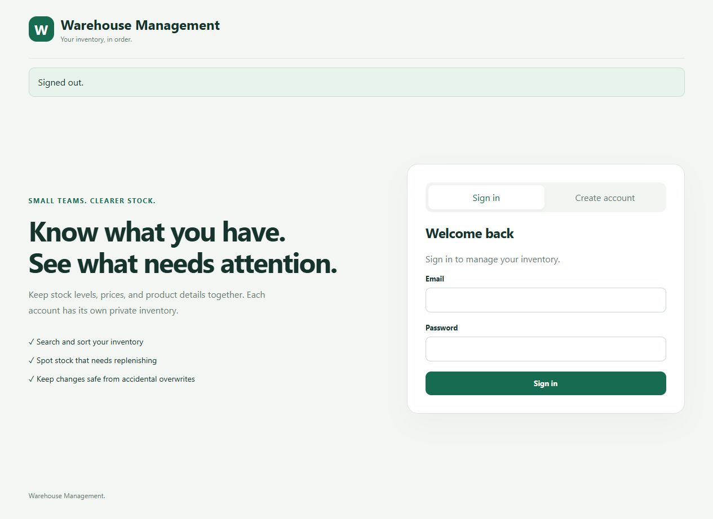
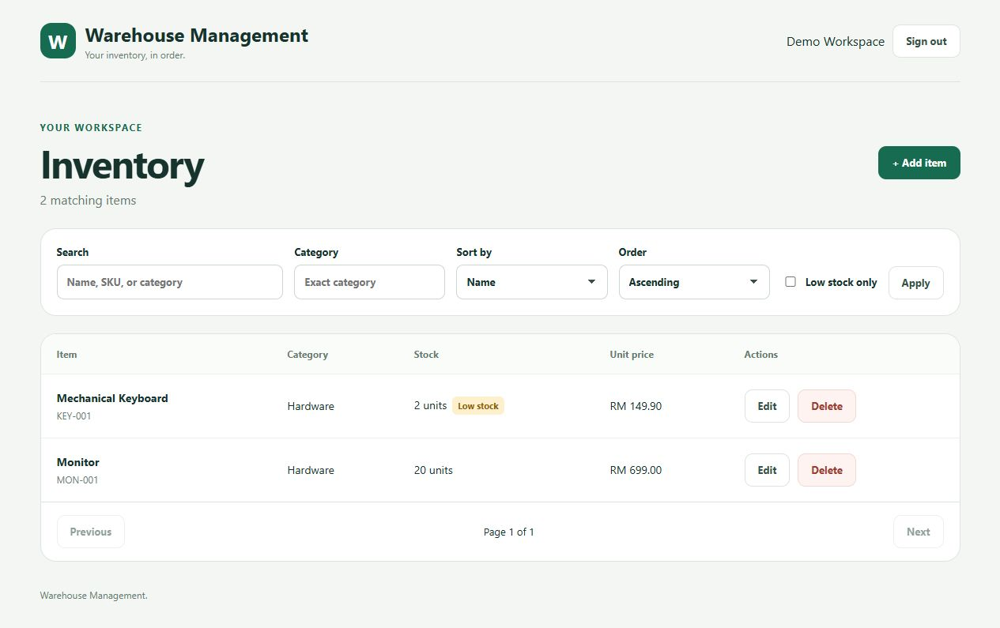
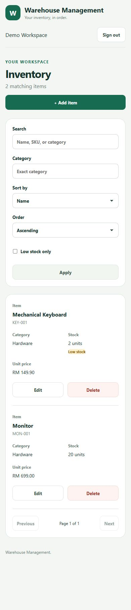

# Warehouse Management

A full-stack inventory application with Java 21, Spring Boot 3.5.16, Spring Security, JPA, Flyway, and a separate HTML/CSS/JavaScript frontend. Each account manages its own inventory.

Repository: [ahmad-kamalul/warehouse-management](https://github.com/ahmad-kamalul/warehouse-management).

## Start here

| Goal | Read |
|---|---|
| Run the application | Local setup below |
| Understand security, SQL, and transactions | [Architecture](docs/ARCHITECTURE.md) |
| Send requests and understand responses | [API reference](docs/API.md) |
| Run automated tests and manual exercises | [Testing guide](docs/TESTING.md) |
| Review planned warehouse capabilities and priorities | [Development roadmap](docs/TODO.md) |

## Features

- Register and sign in with BCrypt password hashing and one-hour bearer JWTs.
- Create, read, update, and delete inventory with account ownership checks.
- Search by name, SKU, or category; filter category/low stock; sort and paginate.
- Reject invalid inputs, duplicate SKUs per owner, and stale updates.
- Use PostgreSQL by default, or file-backed H2 for local learning.
- Exercise the backend through five HTTP integration tests.
- Use a responsive interface with balanced mobile spacing, labeled inventory cards, and visible stock, prices, and action buttons.

## Assessment Implementations

| Requirement | Implementation |
|---|---|
| Java Spring Boot backend | Java 21, Spring Boot, controllers/services/repositories |
| User login and registration | BCrypt passwords and JWT bearer authentication |
| CRUD | Create, list/read, update, and delete inventory owned by the signed-in account |
| SQL database | PostgreSQL configuration and Flyway migration; optional local H2 profile |
| PostgreSQL verification | Five integration tests passed on PostgreSQL 18.1; account and inventory persistence checked after application/database restart |
| RESTful API | Separate JSON endpoints under `/api/auth` and `/api/items` |
| Separate frontend | Static HTML/CSS/JavaScript served independently of Spring Boot |
| Git history and public GitHub repository | Public GitHub repository with commits grouped by setup, backend, frontend, tests, containers, and documentation |
| Optional features | JWT, search/filter/sorting, pagination, application logging, responsive UI, stale-update protection |


## Screenshots

### Sign in



### Desktop inventory



### Mobile inventory



## Prerequisites

- JDK 21 and Maven.
- Python 3 to serve the static frontend with the commands below.
- PostgreSQL for the default profile; optional for the H2 quick start.
- Node.js and npm only for the optional frontend syntax check.

```powershell
java -version
mvn -version
python --version
```

## Run locally with H2

In terminal 1, generate a signing secret for this terminal session and start the backend:

```powershell
$jwtBytes = New-Object byte[] 48
$jwtGenerator = [System.Security.Cryptography.RandomNumberGenerator]::Create()
try {
    $jwtGenerator.GetBytes($jwtBytes)
    $env:JWT_SECRET = [Convert]::ToBase64String($jwtBytes)
} finally {
    $jwtGenerator.Dispose()
}
Set-Location backend
mvn spring-boot:run "-Dspring-boot.run.profiles=local"
```

In terminal 2, starting at the project root:

```powershell
Set-Location frontend
python -m http.server 5173 --bind 127.0.0.1
```

Open [http://localhost:5173](http://localhost:5173) and register an account.

## Run the backend tests

In a separate terminal from the project root:

```powershell
Set-Location backend
mvn verify
```

See the [testing guide](docs/TESTING.md) for single-test commands, IDE debugging, API exercises, and troubleshooting.

## Run with PostgreSQL

Create a PostgreSQL database and a user permitted to create tables in its schema. In the same terminal where you generated `JWT_SECRET`, set your connection values. Starting at the project root:

```powershell
$env:DB_URL = "jdbc:postgresql://localhost:5432/warehouse-management"
$env:DB_USER = "warehouse-management"
$env:DB_PASSWORD = "replace-with-your-local-database-password"
Set-Location backend
mvn spring-boot:run
```

## Configuration

| Variable | Purpose | Default |
|---|---|---|
| `JWT_SECRET` | HMAC signing secret, at least 32 UTF-8 bytes | Required outside tests |
| `DB_URL` | JDBC database URL | `jdbc:postgresql://localhost:5432/warehouse-management` |
| `DB_USER` | Database user | `warehouse-management` |
| `DB_PASSWORD` | PostgreSQL password | Required for the default profile |
| `FRONTEND_ORIGIN` | Single allowed browser origin | `http://localhost:5173` |

Set environment variables in the backend terminal. `local` and `test` profiles supply their own database credentials. The frontend API URL is in [frontend/config.js](frontend/config.js); if changing it for the Nginx image, also update `connect-src` in [frontend/nginx.conf](frontend/nginx.conf).

## Project map

```text
backend/
  pom.xml
  src/main/java/com/ahmad/warehousemanagement/  Controllers, services, entities, security
  src/main/resources/                       Profiles and Flyway migration
  src/test/java/com/ahmad/warehousemanagement/ApiIntegrationTest.java
  src/test/resources/application-test.properties
frontend/                                   Static UI; no bundler required
docs/                                       Architecture, API, testing
```

The Java package is `com.ahmad.warehousemanagement` for both application and test source.

## Boundaries

Tokens live in browser memory, so a page refresh requires signing in again. Logout clears the browser token but does not revoke a copied token. Password reset, email verification, refresh tokens, and login rate limiting are not implemented. Prices display as MYR without a currency column in SQL.
