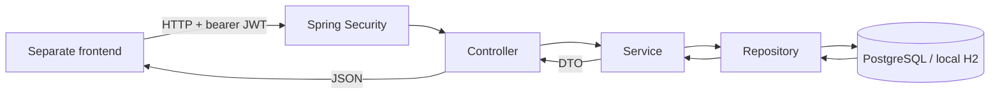

# Architecture and design notes

## Request flow

The frontend gathers input and renders data. It CANNOT connect directly to the database. Controllers define HTTP routes and status codes. Services implement business rules and transaction boundaries. Repositories query SQL. Entities define persistence mappings. DTOs define the public contract.

## Authentication

Registration validates the request, normalizes email, hashes the password using BCrypt, persists the user, and issues a signed JWT. Login compares the submitted password against the hash. Neither passwords nor hashes appear in responses or deliberate application logs.

## Ownership

The owner ID always comes from the verified JWT. Unknown JSON fields are rejected, so `ownerId` cannot be mass-assigned. Single-item lookups combine item ID and owner ID; list queries always include owner ID. Other accounts see a 404 rather than confirmation that the private item exists.

## Search and pagination

Specifications combine predicates without handwritten concatenated SQL. Search is case-insensitive across name, SKU, and category. `%`, `_`, and the escape character are escaped so search input is treated literally. Category is exact and case-insensitive. Low stock means quantity <= reorder level.

Sort fields are allowlisted. ID is a tie-breaker for stable ordering. Page size is limited to 100; numbering begins at 0. Offset pagination is simple, but large or rapidly changing inventories could need cursor pagination and different indexes.

## Error handling

Controller failures become `ApiError` JSON; filter-level authentication failures are handled in security configuration. Validation returns 400 with field details. Duplicates and stale writes return 409. Unknown failures return a generic 500 while the server logs a stack trace.

The service logs registration and inventory changes by ID, not user-provided content or credentials.

## Runtime profiles and test boundaries

| Profile | Database | Signing secret | Intended use |
|---|---|---|---|
| Default | PostgreSQL configured through `DB_URL`, `DB_USER`, `DB_PASSWORD` | `JWT_SECRET` environment variable | PostgreSQL development and deployment configuration |
| `local` | File-backed H2 under `target/local-data/` relative to the backend working directory | `JWT_SECRET` environment variable
| `test` | In-memory H2 in PostgreSQL compatibility mode | Fixed test-only value in test resources | Automated integration tests |
