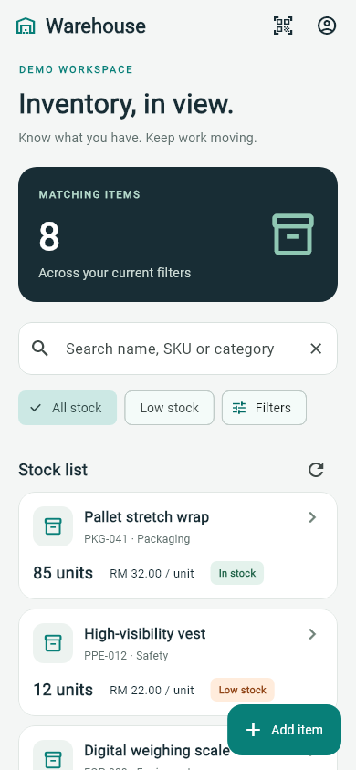

# Warehouse Mobile

A Flutter companion for the existing Warehouse Management Spring Boot API. Android and iOS projects are included. The app uses Material 3, a teal/charcoal palette, account-owned inventory, and MYR pricing.

## What works

- Register, sign in, inspect your account, and sign out.
- Search inventory by name, SKU, or category with debounced requests.
- Filter all/low stock and exact category; sort and paginate on the server.
- Add, view, edit, and delete items; confirm deletion and unsaved changes.
- Validate fields against the API contract, including BCrypt password byte limits.
- Recover from version conflicts by explicitly reloading the latest item.
- Handle loading, empty results, network failures, field errors, and expired sessions.
- Explore a clearly labeled demo workspace with editable sample items.
- Download item master for local stock lookup and scanning.
- Record stock counts, goods in receiving, and goods out dispatch with document references.
- Save transactions locally in SQLite and upload them with duplicate-safe server receipts.

Open **Warehouse operations** using the scanner icon in the inventory toolbar. See the [operations guide](docs/OPERATIONS.md) for scanning, stocktake, receiving, dispatch, upload recovery, and offline behavior. These features require the updated backend and its automatic V2 database migration.

## Start with the demo

Install Flutter **3.47.7 / Dart 3.13.5 or a compatible newer stable version**, Android Studio with its Android SDK, and an emulator or connected Android phone. Run `flutter doctor` to check your setup. iOS requires macOS, Xcode, and Apple signing configuration.

From this directory:

```powershell
flutter pub get
flutter run --dart-define=DEMO_MODE=true
```

Choose your connected Android/iOS device when prompted, then tap **Explore demo workspace**. Demo changes exist only in memory and reset on sign-out or restart. Demo mode never contacts the backend and is never activated automatically after a server failure.

## Connect to the real API

Start the backend using the [repository instructions](../README.md#run-locally-with-h2). The backend remains the source of truth for accounts, ownership, inventory, and concurrency.

```powershell
# Android emulator: 10.0.2.2 reaches the development computer.
flutter run --dart-define=API_BASE_URL=http://10.0.2.2:8080/api

# iOS simulator on a Mac, using an HTTPS development endpoint.
flutter run --dart-define=API_BASE_URL=https://your-development-host.example/api

# Physical device: use an HTTPS endpoint accessible to the device.
flutter run --dart-define=API_BASE_URL=https://your-warehouse.example/api
```

Register an account or use an existing backend account. Inventory is isolated per account. Leave `DEMO_MODE` unset for real API mode. Compile-time defines require a restart/rebuild; hot reload does not change them.

Android **debug** builds permit local HTTP for emulator development. Release builds require HTTPS. iOS retains its default App Transport Security policy; use HTTPS. For an HTTP-only iOS simulator workflow, add a development-only ATS exception through a separate debug plist/build configuration; do not weaken the release plist. Native Android/iOS requests do not need browser CORS changes.

The default base URL is `http://10.0.2.2:8080/api`. There is no embedded server, production hostname, account, password, or signing secret in the app.

## Structure

```text
lib/
  main.dart                       Composition root; selects API or demo
  app.dart                        Theme, session gate, route cleanup
  core/
    api_client.dart               HTTP, bearer token, timeout, API errors
    theme.dart                    Colors, Material theme, shared notice
    validators.dart               Form validation matching backend limits
  domain/
    models.dart                   Immutable item/query/page/user models, money
    warehouse_repository.dart     Data-access contract
  data/
    api_warehouse_repository.dart  Existing REST API adapter
    demo_warehouse_repository.dart In-memory sandbox with version checks
  features/
    warehouse_controller.dart     Session, query, loading, mutation state
    auth/auth_screen.dart         Login and registration
    inventory/
      inventory_screen.dart       Search, filters, paging, account
      item_editor.dart            Details, CRUD, conflict recovery
    operations/                   Master sync, stock check, scanning, outbox uploads
android/                          Native Android host
ios/                              Native iOS host
test/                             Model, API, controller, outbox, and UI tests
docs/                             Architecture, developer notes, screenshots
```

See [architecture](docs/ARCHITECTURE.md) for data flow, design decisions, and an extension guide. See [developer notes](docs/DEVELOPER_NOTES.md) for checks, API mapping, release work, and limitations.

## Verify and build

For native camera, SQLite, offline/retry, and process-restart checks against the live API, use the [emulator acceptance runner and report](docs/EMULATOR_TESTING.md).

```powershell
dart format --output=none --set-exit-if-changed lib test
flutter analyze
flutter test
flutter build apk --debug --dart-define=DEMO_MODE=true
```

The demo APK is generated at `build/app/outputs/flutter-apk/app-debug.apk`. For an API-connected debug APK, omit `DEMO_MODE` and pass `API_BASE_URL` instead. The screenshots are widget-test captures at 390 × 844 logical pixels, not device screenshots. Golden comparison is enabled on Windows; other platforms run the same functional tests without comparing font rasterization.

Release distribution needs your own Android upload key or Apple signing identity, HTTPS hosting, and device QA. See the release notes before building an app bundle. No store publication or deployment is performed by this project.


